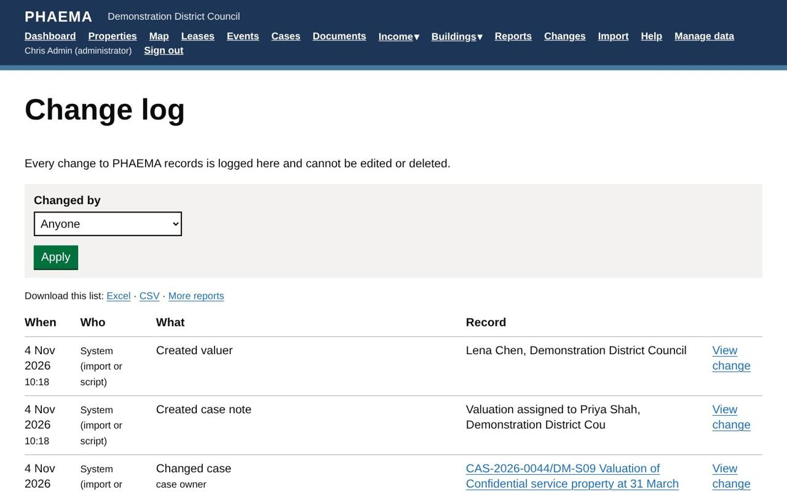

title: Change log
section: Running PHAEMA
order: 3
summary: The permanent record of who changed what, and when.
---
# Change log

Every time a record is added, changed or deleted, PHAEMA records who did it, when, and the old and new values.
This includes changes made in **Manage data**, by outcomes on events, and by [imports](import-export.md).

The change log cannot be edited or deleted, by anyone. It supports the council's audit trail, and the
Golden Thread of information for buildings.

## Seeing changes

- Select **Changes** in the menu for every change, newest first. Filter by who made it. Imports are logged under the
  name of the administrator who confirmed them. Changes made by PHAEMA's daily tasks or by command-line scripts
  show as **System**.
- Each property page has a **History** section with the changes to that property.
- Select a change to see every field that changed, with old and new values.

*Every change, with who and when.*

Download the change log to Excel or CSV from the Changes page, or build a [report](reports.md) on it.
