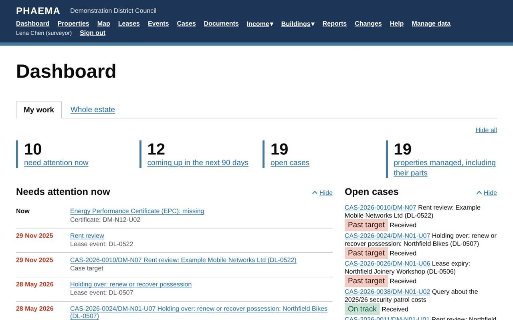
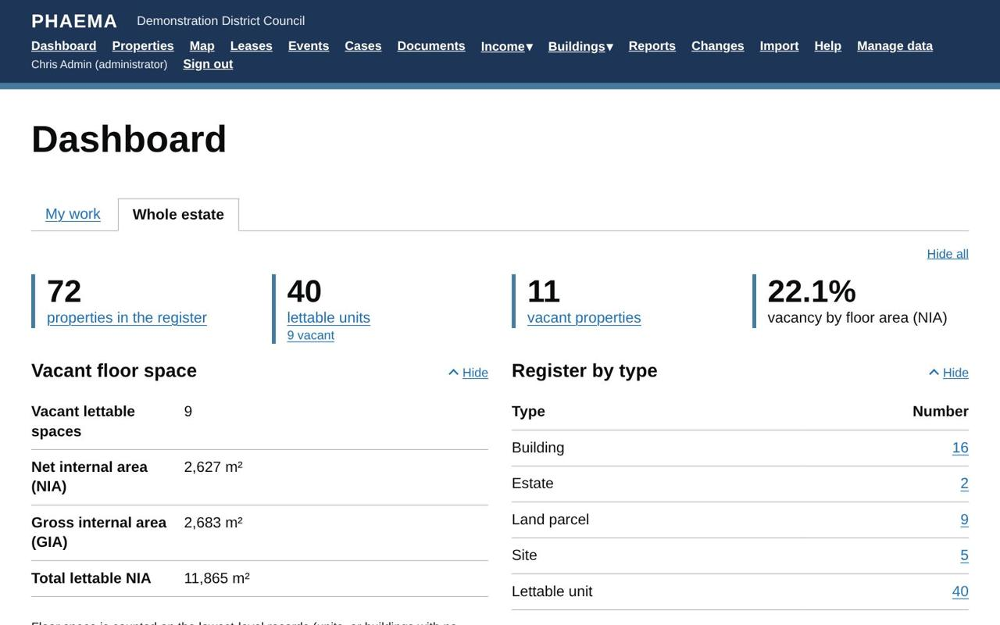

title: The dashboard
section: Start here
order: 2
summary: What the dashboard figures mean and where they come from.
---
# The dashboard

The dashboard is the first page you see after signing in. Everything on it is a link to the records behind it.
It has two tabs: **My work** and **Whole estate**. Surveyors start on My work and everyone else on Whole estate.
PHAEMA remembers the tab you last chose.

## My work

Your own work in one place:

*My work for Lena Chen in the demonstration data.*

- **Needs attention now**: anything overdue or waiting for you, oldest first. This covers your lease events
  (and unassigned events on your properties), cases past their target, your overdue case tasks, approvals waiting
  for you, repairs past target and overdue planned maintenance on your properties, missing or expired
  certificates, and audit queries to answer.
- **Coming up in the next 90 days**: the same things falling due soon, plus certificates expiring and valuations
  assigned to you.
- **Open cases** you own, with how each is doing against its target.
- **Properties managed**: the properties you are managing surveyor for, with their parts, live lettings and rent.
  A surveyor who manages an estate or building also manages everything within it.
- **Compliance**, **rent arrears** and **open repairs** on your properties, when those modules are on.

Supervisors can choose someone they supervise under **Show the work of**, for example to cover absence or for
one-to-ones. Administrators can see anyone's.

## Whole estate

The figures for the whole council, described below.

*The Whole estate tab.*

## Cases

Open [cases](cases.md), how many are past their target date, how many are yours, and overdue case tasks.

## Lease events

A count of open [events](events.md) by type (rent reviews, break notice deadlines, breaks, expiries and other
events), split into **overdue**, **next 6 months** and **future**. Select a number to see those events.

Overdue means the date has passed and nobody has recorded the outcome. Break dates and notice deadlines lapse
automatically once passed, so they never stay overdue.

## Rent roll

The total rent of current agreements, split into rent the council receives (let out) and rent it pays (held).
It also shows:

- **WAULT to expiry**: the weighted average unexpired lease term, weighted by rent. A £100,000 lease with 2 years
  left counts ten times as much as a £10,000 lease with 2 years left. Periodic agreements with no end date are
  left out.
- **WAULT to first break**: the same, but counting to the first break date where there is one.

When the [rent ledger](rent-ledger.md) is switched on, this section also shows the total **rent arrears** and the
**collection rate** over the last 12 months.

## Register and vacancies

The number of properties by type, and the number vacant. **Vacant floor space** shows the net internal area
(NIA) and gross internal area (GIA) that is vacant, and the number of vacant lettable units.

Floor space is counted on the lowest-level records only (units, or buildings with no units), so a building and
its units are never counted twice. See [floor areas](properties.md#floor-areas).

## Recent changes

The latest changes to records, with who made them and when. Select one for the detail, or **See all changes** for
the [change log](change-log.md).
