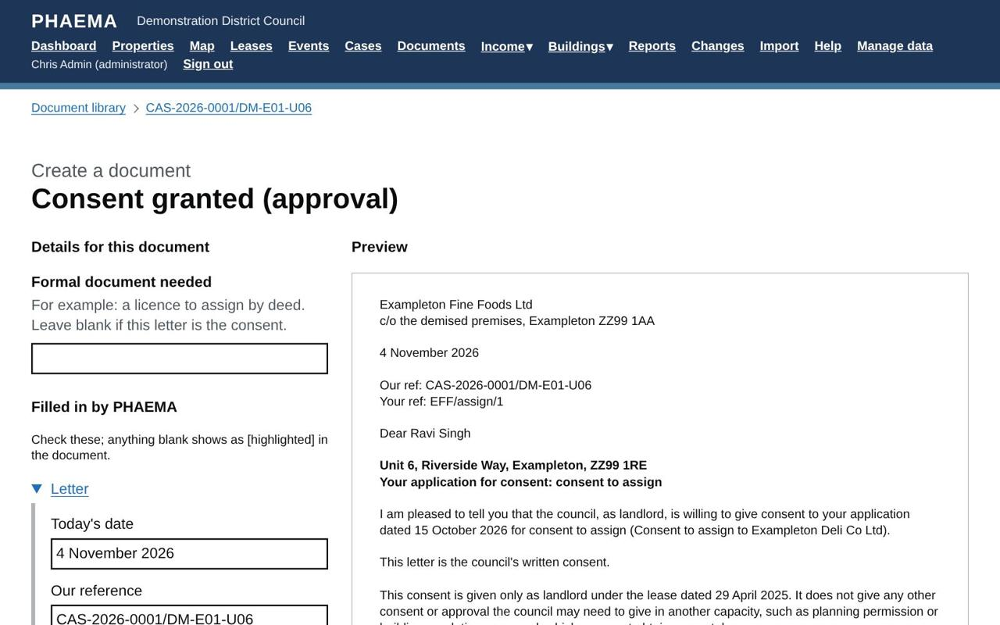
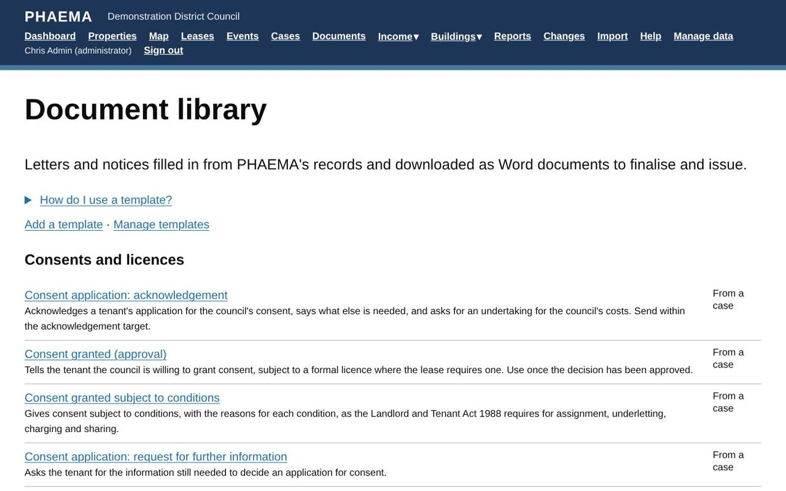

title: Document library
section: Key dates
order: 9
summary: Letters and notices filled in from cases, agreements and valuations, downloaded as Word to finalise and issue.
---
# Document library

The document library holds templates for the letters and notices estates work needs. PHAEMA fills them in from
its records (the tenant, premises, lease, dates, case and valuation details, and your name and job title) and
gives you a Word document to check, finalise and issue. Find it under **Documents** in the menu.

## Creating a document

Most documents are created from a case: open the case and select **Create a letter or notice**. The list shows
the templates for that type of case. Letters about an agreement, such as an arrears reminder, are on the
agreement's page, and the valuer's instruction is on the valuation's page.

*Answer the questions, check the details and preview.*

On the next page:

1. Answer any questions the template asks, such as the conditions of a consent or the reasons for a refusal.
2. Check the details PHAEMA has filled in. Change any of them for this document only: the records are not
   changed.
3. Select **Update the preview** to see the result. Anything PHAEMA could not fill in shows in
   [square brackets], highlighted yellow, here and in Word.
4. Select **Download as Word**. From a case, a copy of the draft is kept on the case unless you untick the box.

Finalise the document in Word, then issue it. File the final, signed version on the case as a document or an
email.

## The templates supplied

| Group | Templates |
|---|---|
| Consents and licences | Acknowledgement of an application; request for further information; request for an undertaking for costs; consent granted; consent subject to conditions, with reasons; consent refused, with reasons; approval of an activity on council land; instruction to legal services |
| Landlord and Tenant Act 1954 notices | Section 25 notice, not opposing (Form 1 particulars); section 25 notice, opposing (Form 2 particulars); counter-notice to a section 26 request; acknowledgement of a section 26 request; section 40 request for information (Form 4 particulars); contracting out: warning notice and declaration |
| Other notices and legal | Section 146 notice; section 17 notice to a former tenant or guarantor (particulars) |
| Lettings and renewals | Heads of terms (from the case's heads of terms); letter to an unrepresented tenant enclosing the RICS Code |
| Rent and rent reviews | Rent review proposal; rent review memorandum |
| Arrears and income | Arrears reminder; final notice before action |
| Lease management | Tenant's break notice acknowledgement; breach of covenant letter; schedule of dilapidations covering letter; rent deposit return |
| Asset valuation | Instruction and terms of engagement to the valuer; response to the auditor's query (from a valuation flagged for audit) |
| General | Enquiry acknowledgement; general letter |

*The library, grouped by subject.*

Consent letters for assignment, underletting, charging and sharing include the written notice of the decision the
Landlord and Tenant Act 1988 requires.

### Prescribed forms

Some notices must be given on a form prescribed by law, for example section 25 notices (Forms 1 and 2 of the
Landlord and Tenant Act 1954, Part 2 (Notices) Regulations 2004), section 40 requests, section 17 notices and the
contracting-out warning notice. For these, PHAEMA produces the **particulars** (names, premises, dates, proposals
or grounds) with a checklist, and a red warning at the top naming the form. Put the particulars on the current
official form, with all its notes, and have the council's legal team check it before it is served.

All the templates are starting points. They are not legal advice: the council's legal team should approve the
council's versions before they are used, and check any notice before it is served.

## Adding and changing templates

Administrators select **Manage templates**. Change a supplied template, or use **Save as new** to make the
council's own copy. To add a template, give it a name, a category, what it is created from (a case, an agreement,
a property or a valuation), the case types it is offered on, and its text.

In the text:

| Write | To get |
|---|---|
| `{{ tenant_name }}` | A detail PHAEMA fills in. The full list of fields is on each template's page. |
| `# Heading` and `## Subheading` | Headings |
| `**bold**` and `*italic*` | Bold and italic text |
| `- item` | A bullet point |
| `1. text` | A numbered paragraph |
| `| Label | {{ value }} |` | A table row |
| `[[signature]]` | The signature block, with the author's name and job title |
| `---` | A new page |
| ` ... ` | Text that only appears when there is a value |

**Questions to ask** are extra details the person creating the document is asked for, such as
`{"key": "conditions", "label": "Conditions", "long": true}`. Use them in the text as `{{ conditions }}`.

The council's name, department, address for service, phone and email in the letterhead come from **Module
settings**, under **Letters and notices**.

## Worked example

On the case for consent to assign Exampleton Fine Foods' lease to Exampleton Deli Co Ltd, select **Create a letter
or notice** and choose **Consent granted (approval)**. PHAEMA fills in the tenant, the premises (Unit 6, Riverside
Way), the lease date and the case reference. Check the preview, download it as Word, add the final wording on any
conditions, sign it, and file the signed copy back on the case.
