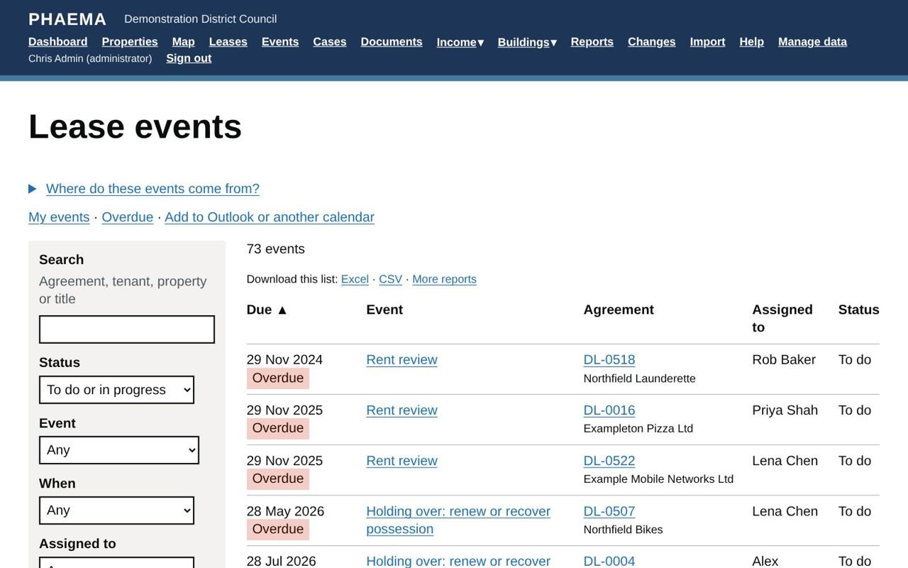
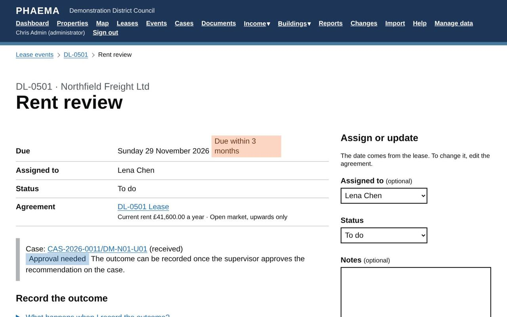

title: Lease events
section: Key dates
order: 1
summary: Rent reviews, break notices, breaks and expiries, and how to record outcomes.
---
# Lease events

An event is a key date on an agreement that someone needs to act on. PHAEMA creates most events itself from the
agreement's terms, and keeps them up to date when the terms change.

| Event | Created from |
|---|---|
| Rent review | The next review date. |
| Break notice deadline | Each break option with a notice period. |
| Break date | Each break option. |
| Lease expiry | The term end. |
| Other | Added by hand with **Add an event** on the agreement page, for example a licence renewal or a repair deadline. |

## Who an event is assigned to

Events are assigned to the managing surveyor of the agreement's premises. An administrator or the surveyor can
reassign an event on its page.

## Status and colours

| Colour | Meaning |
|---|---|
| Red | Overdue: the date has passed with no outcome recorded. |
| Orange | Due within 3 months. |
| Yellow | Due within 6 months. |
| Green | Later. |
| Grey | Completed or lapsed. |

*Lease events, with overdue items in red.*

Events can be **to do**, **in progress**, **completed** or **lapsed**. Use the filters on the **Events** page to
see, for example, your overdue events or everything due in the next 3 months.

## Recording the outcome

Open the event and select **Record the outcome**. What PHAEMA asks for depends on the event.

*A rent review ready for its outcome.*

### Estimated rental value

Rent reviews and lease expiries (renewals) have an **estimated rental value**: the surveyor's view of the market
rent. Enter it under **Assign or update** on the event. The event shows how far it is above or below the current
rent, and it is a column in the events and leases reports.

### Rent reviews

Enter the new rent, the date it takes effect and the next review date. The new rent is added to the
[rent schedule](rent-schedule.md) and the next review event is created. If the rent did not change, enter the
same rent.

### Breaks

For a **break notice deadline**, record either:

- **Break notice served**: the event is completed and the break date event stays open; or
- **No notice served**: the break lapses, and the break date event is closed too.

For a **break date**, record either:

- **Break exercised**: the agreement ends on the break date (its status becomes Ended); or
- **Break not exercised**: the event is closed and the agreement carries on.

Break dates and notice deadlines that pass without an outcome lapse automatically.

### Expiries

Record one of:

- **Tenant vacated**: the agreement ends, on the expiry date unless you enter another date;
- **Renewed**: the agreement ends; record the new agreement separately;
- **Tenant holding over**: the agreement's status becomes Holding over and the event stays in progress until you
  record that the tenant has left or the lease has been renewed.

### Other events

Mark the event completed (or no longer needed) and add notes.

## Cases

PHAEMA opens a [case](cases.md) for each rent review, break and expiry ahead of its date, to hold the work:
notes, emails, tasks and documents. Recording the event's outcome closes the case.

## Reminders

PHAEMA emails people about their upcoming and overdue events, and events can appear in Outlook. See
[reminders and calendar](reminders.md).

## Worked example

Northfield Packaging's lease (DL-0502) has a tenant's break. Six months before the break date, PHAEMA shows a
**break notice deadline** event, assigned to Lena Chen. If the tenant serves notice, she opens the event, selects
**Record the outcome** and chooses **Break notice served**: the break date event stays open. If no notice arrives by
the deadline, she records **No notice served** (or lets it lapse): the break date event closes too, and the lease
runs on to its rent review and expiry.
