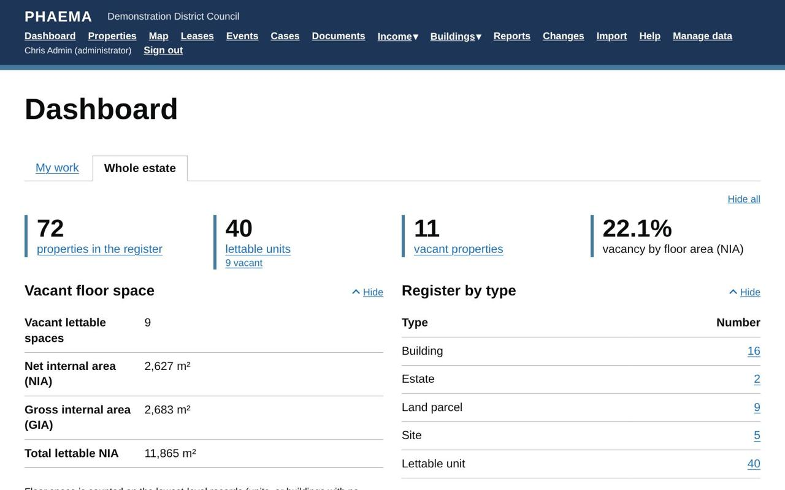
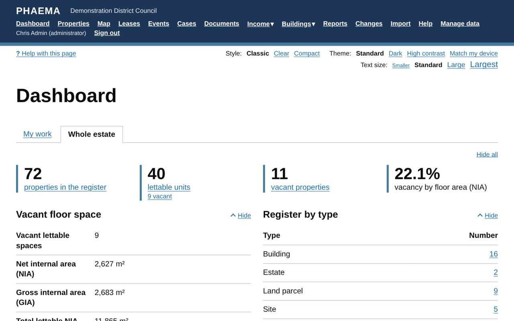

title: Getting started
section: Start here
order: 1
summary: Signing in, the menu, finding records and changing how PHAEMA looks.
---
# Getting started

## Signing in

Use the username and password your PHAEMA administrator gave you. You can type your email address in place of
the username. If you can sign in but see a page saying you
do not have access, you have not been given a [role](users-and-roles.md) yet. Ask an administrator.

## The menu

The menu at the top of every page takes you to:

*The menu runs across the top of every page.*

| Menu item | What it is for |
|---|---|
| Dashboard | A summary of the estate: what needs doing, rent roll, vacancies. See [the dashboard](dashboard.md). |
| Properties | The [property register](properties.md). |
| Map | Every property with a location, on a [map](maps.md). |
| Leases | [Leases and licences](leases.md), with links to [parties](parties.md). |
| Events | [Key dates](events.md) such as rent reviews, breaks and expiries. |
| Cases | [Cases](cases.md): consents, requests and other work from start to outcome. |
| Projects | [Projects](projects.md): developments, acquisitions, disposals and programmes, taken through gateways. |
| Documents | The [document library](documents.md): letters and notices filled in from PHAEMA and downloaded to Word. |
| Income | The [rent ledger](rent-ledger.md) (rents, arrears, receipts) and [service charges](service-charges.md). Shown when the council uses them and your [access areas](users-and-roles.md#access-areas) include them. |
| Buildings | [Maintenance](maintenance.md), [compliance](compliance.md) and [asset valuation](valuations.md). Shown when the council uses them and your [access areas](users-and-roles.md#access-areas) include them. |
| Reports | Ready-made and your own [reports](reports.md), to view or download. |
| Changes | The [change log](change-log.md): who changed what, and when. |
| Import | Administrators, and finance officers for receipts, service charge spending and project spending: [import from spreadsheets](import-export.md). |
| Manage data | Administrators and surveyors: add and edit records. |
| Hand over work | Administrators: move a leaver's or mover's properties, cases and tasks to colleagues ([how](users-and-roles.md#handing-over-work)). |
| Help | This manual. |

## Finding records

Every list (properties, leases, parties, events) has filters on the left and a search box. Choose your filters
and select **Apply**. Select a column heading to sort by it; select it again to reverse the order.

Each list has **Download Excel** and **Download CSV** links. They download exactly what you are looking at,
with your filters and sort order. See [import and export](import-export.md#exporting).

## Adding and changing records

Select **Manage data** (or an **Edit** link on a record's page) to add or change records. Whether you can change
a record depends on your [role](users-and-roles.md). Every change is recorded in the [change log](change-log.md).

## Making PHAEMA easier to read

Under the menu there are three settings that PHAEMA remembers on your computer:

*Style, theme and text size are under the menu.*

- **Theme**: Standard, Dark, High contrast (yellow on black), or Match my device, which follows your computer's
  light or dark setting.
- **Style**: Classic (GOV.UK), Clear (boxed sections and an easy-to-read typeface) or Compact (more on screen).
- **Text size**: make all text smaller or larger.

See [themes and accessibility](settings.md#themes-and-accessibility).
