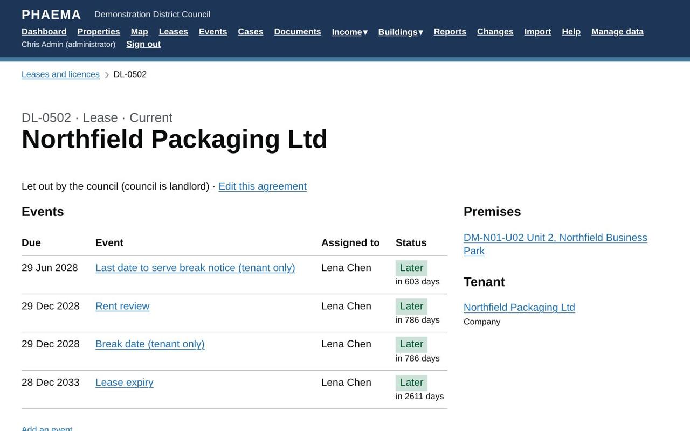

title: Leases and licences
section: Records
order: 3
summary: Recording agreements, their terms, breaks and documents.
---
# Leases and licences

PHAEMA records every agreement over council property: leases, licences, tenancies at will, agreements for lease,
farm business tenancies, wayleaves, easements and concessions. It covers both directions:

- **let out by the council**: the council is landlord and receives rent;
- **held by the council**: the council is tenant and pays rent.

## Adding an agreement

Select **Add a lease or licence** on the lease list, or use **Manage data**. You need:

- a unique **reference**;
- the **tenant or landlord** (a [party](parties.md)), and a guarantor if there is one;
- the **premises**: one or more properties from the register;
- the **term start**, and the **term end** unless the agreement is periodic.

To add many agreements at once, see [importing leases](import-export.md#leases-and-licences).

## Terms

| Field | Notes |
|---|---|
| Status | Proposed (heads of terms), Current, Holding over or Ended. |
| Security of tenure | Whether the lease is inside the Landlord and Tenant Act 1954, Part II, or contracted out. |
| Rent and frequency | The current rent comes from the [rent schedule](rent-schedule.md). |
| Review basis and interval | How and how often the rent is reviewed. The next review date creates a [rent review event](events.md#rent-reviews). |
| Time is of the essence | Tick if the lease makes time of the essence for the rent review, so that missing a date in the review timetable can lose the review. The review is then flagged in red on the [dashboard](dashboard.md#lease-events), the events list and My work. |
| Repairing and insurance | Who repairs and insures. Where the **tenant insures**, the agreement page shows whether an insurance certificate is held and offers a case to get one (see [documents](#documents)). |
| Rent demands on hold | Stops [demand runs](rent-ledger.md#raising-rent) charging the agreement, with the reason. |
| Arrears passed to | Record when the debt has gone to external debt collectors or to legal, the date and their reference. Shown on the [arrears list](rent-ledger.md#arrears). |
| Billing contact | Who rent demands go to. Leave blank to use the tenant's main contact; fill in only what differs (for example an accounts email). |
| Service charge payable | Whether a service charge is due. |
| Rent excludes business rates | Ticked unless the rent includes rates. |
| Rent-free until | The last day of any rent-free period. PHAEMA adds an [event](events.md#options-and-rent-free-periods) for it, so the rent start is not missed. |
| Incentives | Details of any rent-free period or other incentive, for example a fitting-out contribution. |
| Guarantor | Under Premises and parties: the person or company guaranteeing the tenant. Shown on the agreement page and on the guarantor's own party record. |
| Rent deposit, where held, interest | The amount, where it is held (for example the deposit account and the deed's date) and who the interest goes to and when. |
| Alterations and reinstatement | What the tenant may alter, and whether they must reinstate at the end. |
| Special rights | Parking, rights of way, telecoms access and so on. |

*An agreement with its events, premises and tenant.*

These match the items the RICS Code for leasing business premises asks heads of terms to cover, so a renewal case
can start from what the current agreement says.

The agreement page shows the **term** in years and months, the **next payments due** (a guide only: part periods
are not apportioned), and all key dates.

## Break options

Add break options in **Edit this agreement**. For each, record the break date, who can exercise it (tenant,
landlord or either) and the notice period in months. PHAEMA works out the **last date to serve notice** and creates
[events](events.md#breaks) for the notice deadline and the break date.

## Options

Options other than breaks also go in **Edit this agreement**, under **Options**: to renew, to extend the term, to
purchase, a right of first refusal or pre-emption, to take more space, or any other. For each, record who can
exercise it, the dates it can be exercised from and by, any notice period, and its terms (for example the new
term and rent for a renewal, or the price for a purchase). An option with a "must be exercised by" date creates an
[event](events.md#options-and-rent-free-periods), with its own reminder days in Module settings.

## Documents

Under **Documents** on an agreement's page, drag PDFs of the lease, licence, deeds of variation and other
documents onto **Add documents**, or select **Choose files**. Pick the type of document, then **File them**: up
to 20 at a time, each named after its file. To give a document its date or a date for review, or to change or
remove it, use **Edit this agreement**, under Documents. Only signed-in users can open them.

Any document can have a **date for review**: when it should next be looked at. Use it for an insurance
certificate's expiry, a schedule of condition to re-inspect or a side letter that runs out. Documents coming up
for review are counted on the [dashboard](dashboard.md#lease-events), and **Lease events**, then **Documents to
review** lists them. The list can be downloaded, and **Lease documents** is a record type in
[reports](reports.md).

### Tenant's insurance certificate

Where the tenant insures, the agreement page shows the latest **insurance certificate** held, or a warning that
there is none. Select **Start a case to get the tenant's insurance certificate**: the case has tasks to ask for
the certificate, check the cover and add it to the agreement's documents with its expiry as the date for review.

## Rent deposit

Record the deposit the deed requires, where it is held, the deed's date and who the interest belongs to under
**Rent** on the agreement. Then keep the **rent deposit account** (select **Start a rent deposit account** on the
agreement page): each payment in (received, topped up, interest added) and out (drawn down, interest paid to the
tenant, returned), with a reference and a note. The agreement page shows the balance held after each entry, and
warns when the balance is below what the deed requires. A drawdown does not change the rent account: finance records
the money applied, and it comes back in with the receipts.

## Dealings

Assignments, underleases, sharing arrangements, charges and changes of control are recorded under **Dealings** on
the agreement page, from the application to completion.

- **From a consent case.** Starting a *Consent to assign*, *Consent to underlet* or *Consent to share* case on an
  agreement adds a dealing marked **Applied for**. The case's decision moves it on: **Consent given**, **Refused** or
  **Withdrawn**.
- **Adding by hand.** Select **Add or change dealings** to record the assignee or undertenant, any guarantor, whether
  the outgoing tenant gave an authorised guarantee agreement (AGA), the part of the premises, the underlease term
  and rent, the consent case and the signed licence (stored with the agreement's documents).
- **Completing.** When the deed is completed, enter the date and select **Record the assignment** (or **Record
  completion**). For an assignment, the assignee becomes the tenant on the agreement and their guarantor replaces the
  old one. The former tenant is kept: the agreement shows **Who has held this agreement**, and a former tenant who
  gave an AGA is shown as **still liable** on the agreement and on their own page until the next assignment.
- **Arrears.** The rent account belongs to the agreement, not the tenant. If anything is owed, PHAEMA warns you before
  you record an assignment: settle the arrears with the outgoing tenant first.

The **Terms** section records whether assignment and underletting are allowed (with consent, not at all, or freely),
whether dealings with part are allowed, and whether the council can require an AGA. The free-text clause is kept for
the detail.

**Lease chains.** Where the council holds a lease and lets the property on, set **Headlease** on the underlease (under
**Premises and parties**). Each agreement then links to the other.

## Ending an agreement

Record the outcome of the [expiry event](events.md#expiries), or set the status to Ended and fill in the
**actual end** date. Open events for an ended agreement lapse automatically.

## Rents payable

Where the council holds property on a lease or licence (direction **Held by the council (council is tenant)**),
**Finance**, **Rents payable** lists every current agreement with the rent paid, how often, the next payment and
the total due over the next twelve months, then the total due in each month. Payments follow the agreement's rent
schedule, so a stepped rent or a settled review is included, and none are shown before a rent-free period ends.
Reviews, breaks and expiry are shown beside each one, so the team can plan ahead. **Download as Excel** gives the
same as a spreadsheet for finance. PHAEMA does not pay these rents: finance does.

### IFRS 16 data pack

Since 1 April 2024 the CIPFA Code has required councils to account for leases they hold under IFRS 16: a
right-of-use asset and a lease liability for each one, unless it is short-term or of low value. PHAEMA does not do
the accounting. It gives finance the facts they need for it.

On **Rents payable**, open **IFRS 16 data pack**, choose the financial year and select **Download the IFRS 16 data
pack**. Only people with the Finance role (or an administrator) can download it. The workbook has four sheets:

- **Leases**: every agreement the council held during the year, with its dates, the lease end used for IFRS 16,
  the rent now and how often, rent-free period, review basis, breaks and options, the number of months left and
  the total of all payments from 1 April to the lease end, undiscounted. The yellow columns, **Discount rate (%)**
  and **Right-of-use asset value**, are left for finance to fill in.
- **Payments**: each future payment, by date, at the rent in force on that date.
- **Changes in the year**: new agreements, agreements that ended, rent changes from reviews, steps and indexation,
  and changes to the term, end date or IFRS 16 treatment, from the audit trail.
- **Notes**: how the figures were worked out.

Payments are taken in advance on each payment date, from the rent schedule, and none fall before a rent-free
period ends. Index-linked rents are shown at today's rent; finance remeasures the liability when the rent changes.
A rent of £100 a year or less, or a peppercorn, is marked **Nominal**: these leases are still in scope under the
Code and the asset is held at current value, so the row asks for one.

Each agreement held by the council has an **IFRS 16** section in **Manage data**:

- **Treatment**: right-of-use asset and lease liability (the default), short-term, low value, or not a lease.
- **Lease end for IFRS 16**: the end of the lease term finance has assessed, taking into account breaks and
  options the council is reasonably certain to use. Set it for a periodic tenancy or a holding over, which have no
  contractual end date. If it is blank, PHAEMA uses the actual end, then the contractual term end.
- **Notes**: the reason for the treatment or the lease end.

The pack lists anything finance needs to check, such as an agreement with no end date.

## Worked example

**DL-0502** is Northfield Packaging Ltd's lease of Unit 2, Northfield Business Park: ten years, inside the 1954
Act, £39,000 a year plus VAT, reviewed upwards only every five years, on full repairing terms with a service charge.
It records a £9,750 rent deposit held in the council's deposit account, with interest to the tenant. The tenant can
break at year five on six months' notice, so PHAEMA has created a **break notice deadline** event six months before
the **break date** event, as well as the rent review and expiry.

**DL-0530** is the other way round: the council holds the Northfield Innovation Hub on a ten-year lease at £38,000
a year. It counts as rent the council pays, and the council's own break is recorded the same way.
