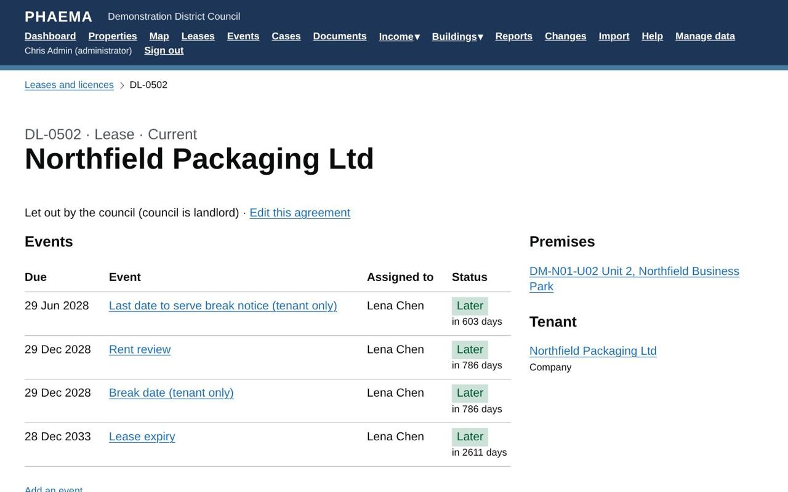

title: Leases and licences
section: Records
order: 3
summary: Recording agreements, their terms, breaks and documents.
---
# Leases and licences

PHAEMA records every agreement over council property: leases, licences, tenancies at will, agreements for lease,
farm business tenancies, wayleaves, easements and concessions. It covers both directions:

- **let out by the council**: the council is landlord and receives rent;
- **held by the council**: the council is tenant and pays rent.

## Adding an agreement

Select **Add a lease or licence** on the lease list, or use **Manage data**. You need:

- a unique **reference**;
- the **tenant or landlord** (a [party](parties.md)), and a guarantor if there is one;
- the **premises**: one or more properties from the register;
- the **term start**, and the **term end** unless the agreement is periodic.

To add many agreements at once, see [importing leases](import-export.md#leases-and-licences).

## Terms

| Field | Notes |
|---|---|
| Status | Proposed (heads of terms), Current, Holding over or Ended. |
| Security of tenure | Whether the lease is inside the Landlord and Tenant Act 1954, Part II, or contracted out. |
| Rent and frequency | The current rent comes from the [rent schedule](rent-schedule.md). |
| Review basis and interval | How and how often the rent is reviewed. The next review date creates a [rent review event](events.md#rent-reviews). |
| Time is of the essence | Tick if the lease makes time of the essence for the rent review, so that missing a date in the review timetable can lose the review. The review is then flagged in red on the [dashboard](dashboard.md#lease-events), the events list and My work. |
| Repairing and insurance | Who repairs and insures. Where the **tenant insures**, the agreement page shows whether an insurance certificate is held and offers a case to get one (see [documents](#documents)). |
| Rent demands on hold | Stops [demand runs](rent-ledger.md#raising-rent) charging the agreement, with the reason. |
| Arrears passed to | Record when the debt has gone to external debt collectors or to legal, the date and their reference. Shown on the [arrears list](rent-ledger.md#arrears). |
| Billing contact | Who rent demands go to. Leave blank to use the tenant's main contact; fill in only what differs (for example an accounts email). |
| Service charge payable | Whether a service charge is due. |
| Rent excludes business rates | Ticked unless the rent includes rates. |
| Incentives | Any rent-free period or other incentive. |
| Rent deposit, where held, interest | The amount, where it is held (for example the deposit account and the deed's date) and who the interest goes to and when. |
| Alterations and reinstatement | What the tenant may alter, and whether they must reinstate at the end. |
| Special rights | Parking, rights of way, telecoms access and so on. |

*An agreement with its events, premises and tenant.*

These match the items the RICS Code for leasing business premises asks heads of terms to cover, so a renewal case
can start from what the current agreement says.

The agreement page shows the **term** in years and months, the **next payments due** (a guide only: part periods
are not apportioned), and all key dates.

## Break options

Add break options in **Edit this agreement**. For each, record the break date, who can exercise it (tenant,
landlord or either) and the notice period in months. PHAEMA works out the **last date to serve notice** and creates
[events](events.md#breaks) for the notice deadline and the break date.

## Documents

Store PDFs of the lease, licence, deeds of variation and other documents in **Edit this agreement**, under
Documents. Only signed-in users can open them.

Any document can have a **date for review**: when it should next be looked at. Use it for an insurance
certificate's expiry, a schedule of condition to re-inspect or a side letter that runs out. Documents coming up
for review are counted on the [dashboard](dashboard.md#lease-events), and **Lease events**, then **Documents to
review** lists them. The list can be downloaded, and **Lease documents** is a record type in
[reports](reports.md).

### Tenant's insurance certificate

Where the tenant insures, the agreement page shows the latest **insurance certificate** held, or a warning that
there is none. Select **Start a case to get the tenant's insurance certificate**: the case has tasks to ask for
the certificate, check the cover and add it to the agreement's documents with its expiry as the date for review.

## Ending an agreement

Record the outcome of the [expiry event](events.md#expiries), or set the status to Ended and fill in the
**actual end** date. Open events for an ended agreement lapse automatically.

## Worked example

**DL-0502** is Northfield Packaging Ltd's lease of Unit 2, Northfield Business Park: ten years, inside the 1954
Act, £39,000 a year plus VAT, reviewed upwards only every five years, on full repairing terms with a service charge.
It records a £9,750 rent deposit held in the council's deposit account, with interest to the tenant. The tenant can
break at year five on six months' notice, so PHAEMA has created a **break notice deadline** event six months before
the **break date** event, as well as the rent review and expiry.

**DL-0530** is the other way round: the council holds the Northfield Innovation Hub on a ten-year lease at £38,000
a year. It counts as rent the council pays, and the council's own break is recorded the same way.
