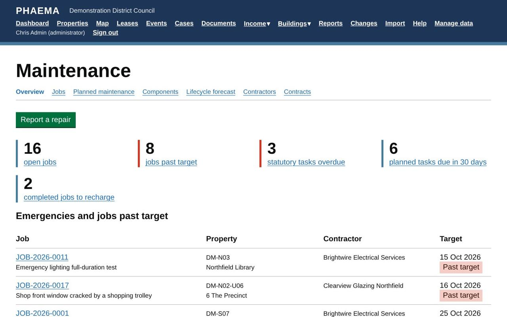
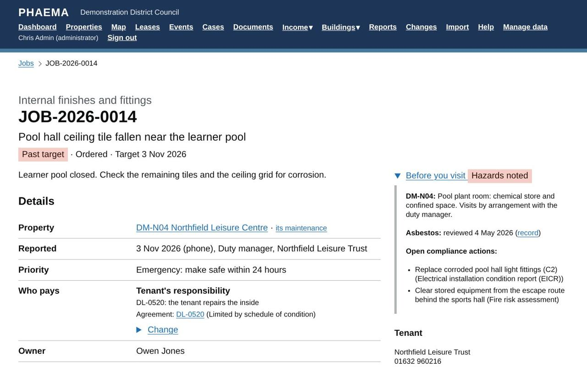
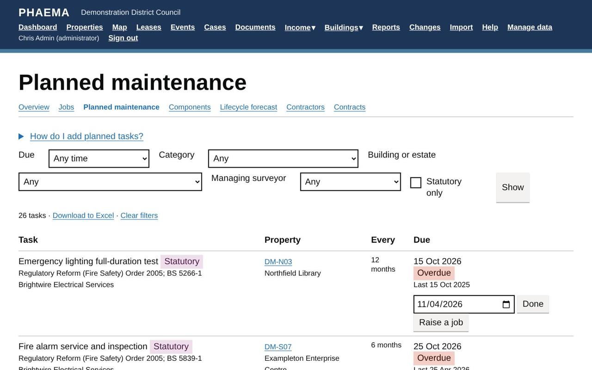
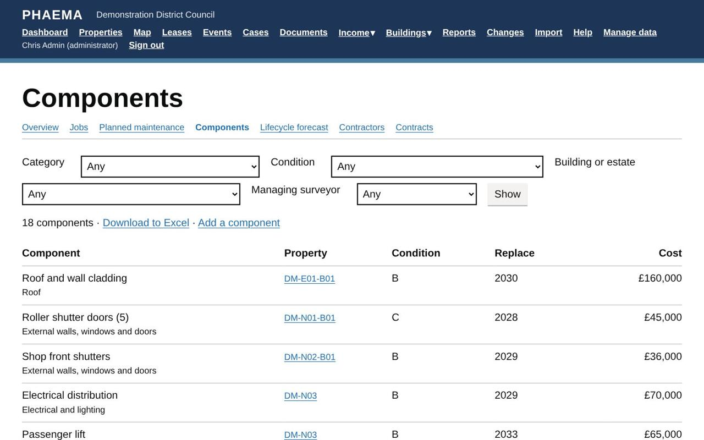

title: Maintenance
section: Key dates
order: 6
summary: Repairs and works orders, planned and statutory maintenance, components, contractors and who pays.
---
# Maintenance

Maintenance is an optional module. An administrator switches it on under **Manage data**, **Module settings**,
by ticking **Maintenance**. It then appears under **Buildings** in the menu, with an **Overview** of emergencies, jobs past target,
overdue statutory tasks, contracts to re-tender and contractors whose insurance is running out.

What sets PHAEMA apart is that maintenance is linked to the lease: who pays for a repair is worked out from the
lease repairing terms, and the cost can go straight to the tenant's rent account or the service charge.

## Reporting a repair

Select **Report a repair**, or **Report a repair** on a property's maintenance page. Choose the property, say
what needs doing, pick a category (roof, heating, electrical and so on) and a priority:

*The overview: emergencies, jobs past target and what is due.*

| Priority | Target |
|---|---|
| Emergency | Make safe the same day |
| Urgent | Within 5 working days |
| Routine | Within 20 working days |
| Planned | The planned task's due date |

Weekends and England and Wales bank holidays are not counted. Each job gets a number such as **JOB-2026-0042**,
which is also the works order number.

## Who pays

PHAEMA suggests who pays from the current lease of the property:

*A job shows who pays, and the hazards before anyone visits.*

| Lease | Repairs to the inside | Structure, roof and exterior |
|---|---|---|
| Full repairing | Tenant | Tenant |
| Internal repairing, or limited by a schedule of condition | Tenant | Council, through the service charge if the lease has one |
| Landlord repairs | Council (service charge if there is one) | Council (service charge if there is one) |
| Not let | Council | Council |

Common parts of a building with let units go to the service charge when the leases have one. A property's
maintenance page shows the whole table for that property. The suggestion is a starting point: change it on the
job, with a reason, for example **Council, recharged to the tenant** for damage they caused. Always check the lease itself
for anything unusual.

## Works orders and approval

On the job, choose the contractor, enter the estimate and any purchase order number from the finance system, then
**Issue the works order**. PHAEMA can email the order to the contractor, and **Print the works order** gives a
printable copy. PHAEMA warns if the contractor's insurance has expired or is not recorded.

Orders estimated above the approval limit (£5,000 unless an administrator changes it in **Module settings**)
need approval first. Select **Ask *your supervisor* to approve the order**: your supervisor is emailed and sees it
on their dashboard. Nobody approves their own order; administrators can approve any. If the estimate changes
after approval, it needs approving again. Supervisors are set on each user record (see
[Users and roles](users-and-roles.md#supervisors)).

## Completing and paying

Record the completion date, the work done, the final cost and the contractor's invoice number. Add photos and
certificates as documents. Then, depending on who pays:

- **Recharged to the tenant:** select **Recharge the cost** to add a charge to the tenant's
  [rent account](rent-ledger.md), with VAT if the lease is opted.
- **Service charge:** choose the service charge year and heading to add the cost to that year's
  [spending](service-charges.md).

Close the job when everything is settled.

## Planned maintenance

On a property's maintenance page, **Add tasks from the library** lists common planned and statutory tasks, such
as gas safety checks, fixed electrical inspections (EICR), fire alarm servicing, emergency lighting tests,
legionella risk assessments, asbestos re-inspections and lift thorough examinations, each with its usual
frequency and the law or standard behind it. Tick the ones that apply, set the first due date and the
contractor. Change any task's frequency or dates under **Manage data**. The library is PHAEMA's own; check
frequencies against your risk assessments, written schemes and the manufacturers' instructions.

*Planned and statutory tasks, overdue first.*

PHAEMA raises a job for each task 28 days before it is due (change this per task, or leave it blank to raise jobs
by hand). Completing the job records the task as done and sets the next due date. You can also select **Done**
on the task itself. Overdue statutory tasks show red on the dashboard and the overview.

## Components and the lifecycle forecast

The component register records the parts of each building that wear out: roofs, boilers, lifts, windows, fire
alarms. Add them under **Add a component** on a property's maintenance page. For each, record the category,
Uniclass 2015 code and NRM3 element if you use them, the year installed and expected life, the condition grade
(A good, B satisfactory, C poor, D bad) and the replacement cost.

*Components with condition and replacement cost.*

**Lifecycle forecast** shows when components fall due for replacement over 5 to 30 years, and the cost each year,
split between capital and revenue. Download it to Excel for the capital programme.

## Contractors

Administrators add contractors under **Manage data**, with contact details, out of hours number, insurer, public
liability cover, insurance expiry date and accreditations. A contractor's page shows their jobs, contracts and
spend in the last 12 months.

## Contracts

The contracts register records service contracts, such as fire alarm servicing or water hygiene, with their
term, annual value and the properties they cover. The RICS professional standard on service charges in
commercial property expects contracts to be re-tendered or benchmarked at least every three years, so PHAEMA
shows when each is due and lists those due within six months on the overview. Record the date a contract was
last tendered or benchmarked to move the date on.

## Filtering by building or surveyor

The repair jobs, planned maintenance, components, lifecycle forecast and contracts pages can be filtered by
**building or estate** (including every unit and part within it) and by **managing surveyor** (or "Mine"). The
same filters are on the cases, lease events, leases, compliance and asset valuation pages. Downloads to Excel
follow the filters.

## Reports

The **Maintenance** ready-made reports include repairs past target, statutory maintenance overdue, planned
maintenance due in 90 days, repair spending in the last 12 months, components in poor or bad condition,
contracts due for re-tender and contractor insurance expiring.

## Worked example

At **DM-N04 Northfield Leisure Centre** a ceiling tile has fallen near the learner pool. The job is reported as an
**emergency**, so its target is the same day, and the works order goes to the building contractor straight away.
**Who pays** shows PHAEMA's suggestion from the leisure trust's
lease (DL-0520), which keeps structural repairs with the council: check the lease and change it with a reason if
needed. The job page's **Before you visit** panel warns about the pool plant room.

At **DM-N09 Northfield Market Hall**, replacing cracked panes in the roof lantern is estimated at £14,800, above the
£5,000 approval limit, so the order waits for Sam Hughes to approve it. At Unit 6 of the business park, graffiti on
the shutter was removed for £180 and marked
**Council, recharged to the tenant**: select **Recharge the cost** to add it to the tenant's rent account.
