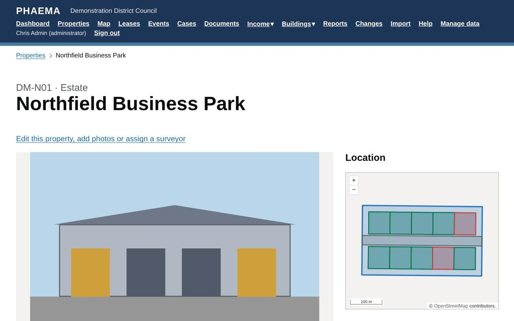
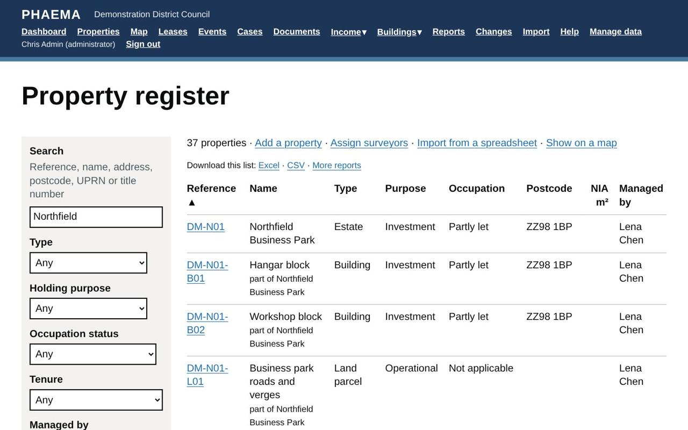

title: Properties
section: Records
order: 1
summary: The property register, the property hierarchy, floor areas, photos and titles.
---
# Properties

The property register holds every property the council owns, leases or manages, except housing stock.

## How properties fit together

Properties form a hierarchy. Each property can be **part of** another:

*An estate's record, with its location and photo.*

- **Estate**: a group of sites managed together, such as an industrial estate.
- **Site**: one piece of land, which can hold buildings.
- **Building**: a building on a site.
- **Lettable unit**: a part of a building that can be let, such as a shop or office suite.
- **Land parcel**: land without buildings, such as a field or car park.

A property's page lists its parts. Lettable parts are shown in bold.

## Key facts

| Field | Meaning |
|---|---|
| Reference | The council's unique asset reference. |
| UPRN / USRN | The national Unique Property and Unique Street Reference Numbers. They link PHAEMA to GIS, council tax, business rates and other systems. |
| Holding purpose | Why the council holds it: operational, investment, community, surplus, or held for disposal. |
| Estate strategy section | The section of the council's estate strategy or asset management plan that covers the property. Blank until the council fills it in. |
| Holding purpose review date | When the reason for holding the property is next due for review. The register can be filtered to reviews that are overdue or due in the next 12 months. |
| Portfolio | The service or portfolio the property belongs to, such as Investment, Leisure, Children's services or Adult social care. See [portfolios](#portfolios). |
| Tenure | Freehold, leasehold, other, or none (managed but not owned). |
| Occupation | Occupied by the council, let, partly let, vacant, or not applicable. |
| Managing surveyor | The surveyor responsible. Surveyors can change the properties they manage (see [roles](users-and-roles.md)). Events on the property's leases are assigned to them. |
| Exclude from open data | Tick for sensitive properties so they are left out of any published asset list. |
| Disposed of, disposal price | When the council sold or transferred it, and for how much. A disposed property is kept for its history but left out of open data. Usually recorded from a disposal project's [completion checklist](projects.md#completion-checklist). |
| Site hazards | What anyone visiting should know first, such as fragile roofs, confined spaces, lone working or dogs. Shown on cases, jobs and valuations for the property and everything within it. |

*The register, searched for Northfield.*

## Portfolios

A portfolio groups properties by the service or purpose they belong to, alongside the holding purpose. Each
council keeps its own list: an administrator opens **Manage data**, **Portfolios** to add, rename or reorder them.
PHAEMA starts with a list typical of a large council (Investment, Corporate estate, Leisure, Libraries,
Children's services, Education, Adult social care, Highways and transport, Bereavement services and others).

- Choose a property's portfolio in **Edit this property**, under Classification, or in the
  **Portfolio** column of a [spreadsheet import](import-export.md).
- Filter the register by portfolio, sort it by the **Portfolio** column, or select a portfolio on a property's
  page to see everything in it.
- In the [report builder](reports.md), Portfolio is a column and a filter in the Properties dataset, so you can
  total floor areas, rents or values by portfolio.
- A portfolio with properties in it cannot be deleted. Untick **In use** to stop offering it for new
  properties; properties already in it keep it.

## Floor areas

PHAEMA records **gross internal area (GIA)** and **net internal area (NIA)** in square metres, and site area in
hectares. The property page shows how the floor area is made up:

- total GIA and NIA of the buildings within;
- total NIA of the lettable parts;
- **non-lettable area**: GIA less lettable NIA, which covers common parts, circulation, plant and walls;
- **net to gross**: lettable NIA as a percentage of GIA.

### How areas were measured

RICS asks for the measurement basis to be recorded. For each property, record in **Edit this property**:

- **measured to**: the RICS Code of Measuring Practice (6th edition) or IPMS: All Buildings;
- the **source**: a measured survey, drawings, a lease or title plan, or an estimate;
- the **date** the areas were measured.

Estimated areas are marked as estimates wherever they are shown. You can also record the **gross external area
(GEA)**, used for planning, insurance and some valuations. The ready-made report **Floor areas with no measurement basis** lists
properties still to be checked.

## Photos

Add photos in **Edit this property or add photos**. They are resized and their location data removed when
uploaded. Select a photo on the property page to see it full size.

## Titles

Land Registry titles are linked to properties. A title can hold a PDF of the register and plan. Administrators
manage titles. See also [Land Registry boundaries](maps.md#land-registry-inspire-boundaries).

## Leases on a property

The property page lists the leases and licences that include it. See [leases and licences](leases.md).

## Projects on a property

The property page lists the [projects](projects.md) it is part of, including those of the estate or building it
belongs to. Confidential projects are listed only for their team and administrators.

## Worked example

In the demonstration data, **DM-N01 Northfield Business Park** is an estate. Its parts are the **Hangar block**
(DM-N01-B01, units 1 to 5), the **Workshop block** (DM-N01-B02, units 6 to 10) and the estate roads (DM-N01-L01).
Units 4 and 10 are vacant, so the estate shows as partly let.

Lena Chen is the managing surveyor of DM-N01, so she also manages every block and unit within it: their events
are assigned to her and she can change them. **DM-N06 Former Northfield bus depot** has no managing surveyor (filter
the register by **Managing surveyor: Nobody** to find it) and records site hazards, which appear on every case,
job and valuation for it.
