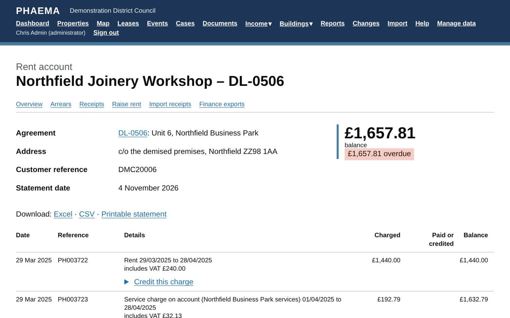
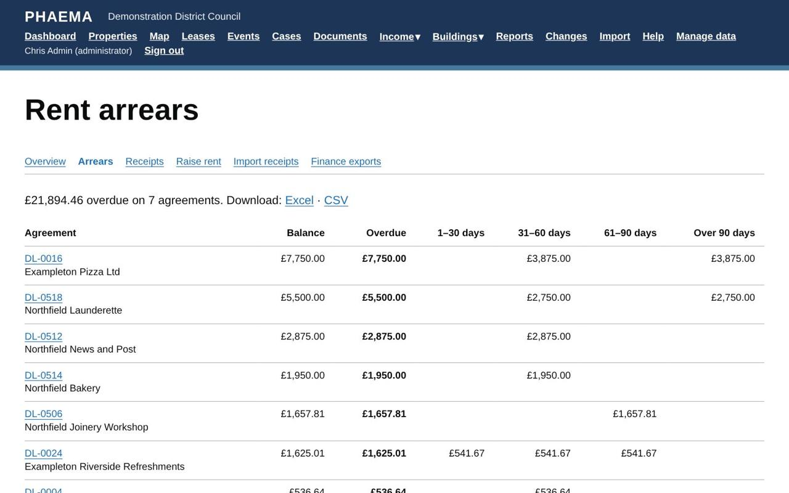

title: Rent ledger
section: Key dates
order: 4
summary: Raising rent, credit notes, receipts, arrears, statements and the finance export.
---
# Rent ledger

The rent ledger charges rent on agreements the council lets out, records payments from the finance system,
and shows what each tenant owes. It is an optional module: an administrator switches it on in
[settings](settings.md#rent-ledger-settings). When it is on, **Rents receivable** appears in the **Finance** menu.

## Who can see and do what

What you see depends on your [access areas](users-and-roles.md#access-areas). Finance staff and administrators
see every account. People in the Estates area see rent and arrears for their own patch: the properties they
manage, those of everyone they supervise, and anyone they are covering for. Raising rent, credit notes and the
finance export are for administrators and finance officers.

## Who raises the invoices

Councils work in one of two ways, chosen in settings:

| Setting | What happens |
|---|---|
| PHAEMA numbers the invoices | Each charge gets an invoice number from PHAEMA (for example PH000123). The finance system records the invoices and collects the money. |
| The finance system raises the invoices | PHAEMA works out what is due and sends it to finance with its own reference (for example PHC000123). Finance raises and numbers the invoices. |

Either way, the [finance export](#the-finance-export) is how charges reach the finance system, and
[receipts](#receipts) come back the same way.

## Raising rent

Administrators and finance officers: select **Finance**, **Rents receivable**, then **Raise rent**.

1. Choose the range of **payment dates** to charge, for example the next quarter, and the **issue date**.
2. Select **Preview the charges**. PHAEMA lists every charge due between the dates on current and holding-over
   agreements let out by the council.
3. Check the list and select **Raise these charges**.

How PHAEMA works out each charge:

- Rent is due in advance on each payment date, from the agreement's rent frequency (quarter days, other quarterly
  dates, monthly or annually).
- The amount is the annual rent in force on the first day of the period, from the [rent schedule](rent-schedule.md),
  divided by the number of payments a year.
- **Part periods** are apportioned by day (annual rent × days ÷ 365). This happens when an agreement starts
  between quarter days, which is charged from the start date to the day before the first quarter day, or when it
  ends part way through a period.
- **VAT** is added at the standard rate where the agreement is marked VAT chargeable (the council has opted to tax).
- Agreements at a peppercorn or no rent, and agreements where the council is the tenant, are not charged.
- When the [service charge](service-charges.md) module is on, the same run also charges service charges on
  account. Choose **Rent only**, **Service charges only**, or both.
- **Rent for a period is only ever charged once**, so runs can overlap without charging twice.
- Agreements with **rent demands on hold** are left out (rent and service charges), and the preview names them.
  Put an agreement on hold in **Edit this agreement**. When the hold is taken off, run the same dates again and
  PHAEMA raises what was missed.

Charges cannot be deleted. Correct a mistake with a [credit note](#credit-notes).

## Rent accounts and statements

Each agreement has a rent account, which you can open from the agreement's page, the arrears list or the receipts
list. It shows every charge and payment in date order with a running balance, and marks what is still owed on each
charge, and whether it is overdue.

*A rent account with its running balance.*

Payments are set against the **oldest debt first**. The account can be downloaded to Excel or CSV, or opened as a
**printable statement** to send to the tenant.

A party's page shows the balance of each of their agreements.

## Credit notes

Administrators can credit a charge, in full or in part, from the rent account: open **Credit this charge**, enter
the amount (or leave it blank for the whole charge) and a reason. VAT is credited in proportion. A credit note
gets an invoice number in the same series and goes to finance in the next export.

## Receipts

Payments are recorded in the finance system and imported into PHAEMA. Administrators and finance officers: select **Finance**, **Rents receivable**, then
**Import receipts**, and follow the usual [import steps](import-export.md#how-every-import-works).

Each payment is matched to an agreement by, in order:

1. the **lease reference**, if given;
2. the **invoice reference** the payer quoted, which can be a PHAEMA invoice number or PHC reference;
3. the **customer reference**, but only if that customer has a single agreement.

Payments already in PHAEMA (same payment reference) are left alone, so importing the same file twice is safe.
A negative amount records a refund or a returned payment.

## Arrears

**Finance**, **Arrears**, lists every agreement with overdue rent, aged by how long it has been overdue:
1–30 days, 31–60 days, 61–90 days and over 90 days. Download it to Excel for arrears meetings. The
[dashboard](dashboard.md) shows the total arrears and the collection rate.

*Arrears, aged.*

An agreement whose debt has been **passed to external debt collectors or to legal** is tagged on the list, with
the date. Record it in **Edit this agreement**, under Rent demands and arrears. Filter the list to see only those
passed over, or only those still with the council; the download includes the same columns.

The **collection rate** is the rent received in the last 12 months as a percentage of the rent that fell due in the
same period.

## Credit control

**Finance**, **Rents receivable**, **Credit control** lists the accounts with overdue rent and the next step for
each, oldest debt first. The steps are the council's credit control stages, taken in order once the oldest unpaid
charge is old enough. By default:

| Stage | When | What PHAEMA does |
|---|---|---|
| Reminder letter | 7 days overdue | Offers the *Rent arrears: reminder* letter; select **Letter sent** when it has gone. |
| Final notice | 21 days | Offers the *Rent arrears: final notice* letter. |
| Rent arrears recovery case | 35 days | Opens a *Rent arrears recovery* case for the managing surveyor (each night, by itself, if nobody has). |
| Review | 60 days | Decide on a payment plan, debt collectors or legal action. |

Administrators change the stages, their timing, the letters and a minimum debt under **Manage data**, **Credit
control stages**. A stage is asked for once for each debt: when the account is clear, the next debt starts again
from the first stage. The steps taken are listed on the rent account.

Accounts are not chased while **rent demands are on hold**, after the debt is **passed to** debt collectors or legal,
or while a **payment plan** is being kept.

## Payment plans

On a rent account with overdue rent, **Set up a payment plan** with the arrears to clear, the number of instalments,
weekly or monthly, and the first date. Usually the tenant also pays the rent as it falls due; untick that if not.
Setting up a plan replaces any earlier one.

PHAEMA checks the plan against the payments received. If the tenant falls behind the instalments (or, where agreed,
the current rent) by more than the days allowed (7 by default), the plan is marked **Broken**, it is flagged on the
credit control list and chasing starts again. When the arrears covered are paid, the plan is **Completed**.

## Interest on late payment

Most leases charge interest on rent paid late. Record the terms on the agreement (**Manage data**, the agreement,
**Rent demands and arrears**): Bank of England base rate plus a margin, or a fixed rate; and how many days late the
rent must be before interest runs (it then runs from the due date).

The rent account shows the interest on each late charge to today: the days it was unpaid and the interest. It is
simple interest over a 365-day year, worked out on the amount actually unpaid each day (payments clear the oldest
debt first; a credit note clears the charge it credits), and is never charged on interest. Someone with finance
rights checks it against the lease and selects **Charge interest**. The interest charge goes to finance like any
other charge, and the next calculation starts the day after it.

For base rate leases, administrators keep the **Bank of England base rates** under **Manage data**, each with the
date it took effect.

## The finance export

**Finance**, **Rents receivable**, then **Finance exports**, collects every charge and credit note not yet sent to finance into a numbered
export. Download it as Excel or CSV and load it into the finance system. Each charge is only ever in one export,
and earlier exports can be downloaded again.

The columns are fixed, so the finance team can map them once:

| Column | Contents |
|---|---|
| Record type | Invoice or Credit note. |
| PHAEMA reference | PHAEMA's unique reference for the charge (PHC…). |
| Invoice number | PHAEMA's invoice number, if PHAEMA numbers invoices. |
| Credit for | For a credit note, the invoice it credits. |
| Customer reference, name, address | From the [party](parties.md). The customer reference is the party's finance customer reference. The address is the agreement's billing address where one is set. |
| Lease reference, Premises, UPRN | The agreement and its properties. |
| Description, Period from, Period to | What the charge is for. |
| Issue date, Due date | |
| Net, VAT code, VAT rate, VAT, Gross | Amounts in pounds; credit notes are negative. The VAT codes are set in settings. |
| Income code | The rent or service charge income ledger code set in settings. |
| Billing contact, Billing email | The agreement's billing contact, or the tenant's main contact if none is set. Added at the end so existing mappings are not disturbed. |

## Other reports

The [report builder](reports.md) has **Rent charges** and **Rent receipts** datasets, for example to list the rent
charged on one estate, or the charges still waiting to go to finance.

## Worked example

Northfield Joinery Workshop (DL-0506) pays £14,400 a year monthly in advance, plus VAT: £1,440 a month. Its rent
account shows the last two monthly charges unpaid, so it appears on the **Arrears** list, aged by how long each
charge has been overdue. Northfield Bakery (DL-0514) has paid only part of its latest charge: payments are set against the
oldest debt first, so the balance shows on that charge. To agree an allowance with a tenant, open the charge on the
rent account, select **Credit this charge**, enter the amount and the reason.
