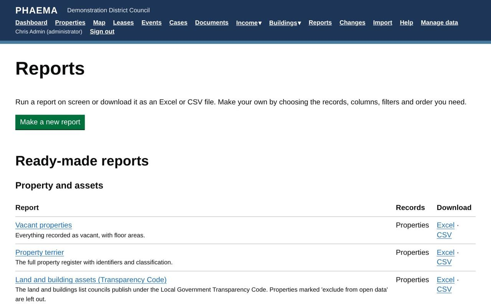
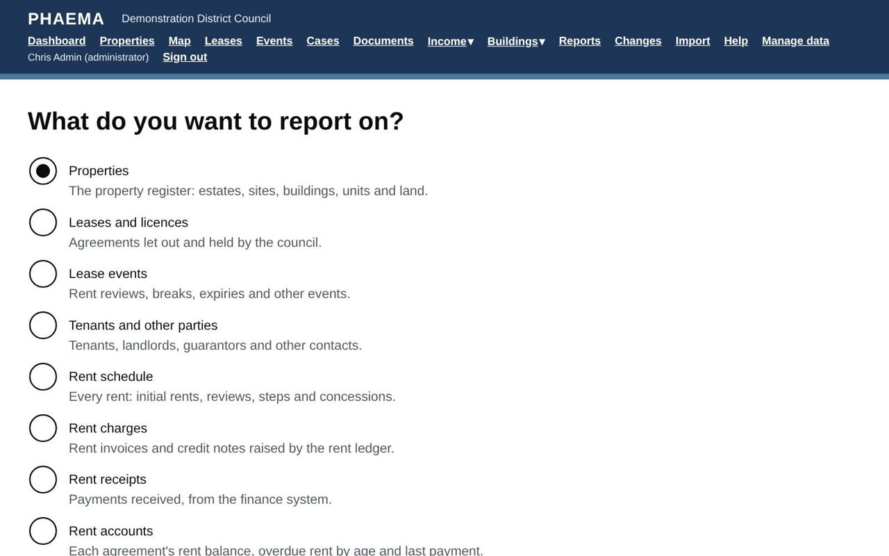

title: Reports
section: Data in and out
order: 2
summary: Ready-made reports, building your own, sharing them and downloading to Excel.
---
# Reports

Select **Reports** in the menu. Any report can be viewed on screen or downloaded as an Excel or CSV file. A report
always shows the data as it is now, so run it again to get up-to-date figures.

## Ready-made reports

Ready-made reports are grouped by topic. Reports for an optional module (rent ledger, service charges,
maintenance, compliance, asset valuation) appear when that module is switched on.

*Ready-made reports grouped by topic.*

### Property and assets

| Report | What it shows |
|---|---|
| Property terrier | The full property register with identifiers and classification. |
| Vacant properties | Vacant properties and their floor areas. |
| Land and building assets (Transparency Code) | The list councils publish under the Local Government Transparency Code: UPRN, name, address, grid reference, tenure and type. Properties marked "exclude from open data" are left out. |
| Surplus and held for disposal | Property declared surplus or held for disposal, for asset reviews. |

### Leases and key dates

| Report | What it shows |
|---|---|
| Rent roll | Current agreements let out by the council, with rents, largest first. |
| Lease expiries in the next 12 months | Agreements ending in the next year. |
| Overdue lease events | Events past their date with no outcome recorded. |
| Rent reviews in the next 12 months | Open reviews, with the current rent, to plan negotiations. |
| Breaks and notice deadlines in the next 18 months | So that no break is missed. |
| Agreements holding over | Tenants still in occupation after their term ended. |
| 1954 Act protected leases: ended or ending within 2 years | Leases with security of tenure that need section 25 notices or renewal planning, including any already continuing past their term. |
| Nil and peppercorn rent lettings | Agreements let at no rent, for community lettings and subsidy reporting. |
| Property leased in by the council | Agreements where the council is the tenant, with the rent it pays. |
| Rent deposits held | Live agreements with a deposit, where it is held and who the interest belongs to. |

### Cases

| Report | What it shows |
|---|---|
| Open cases by stage and owner | Every open case. |
| Cases past their target date | Open cases whose target has passed. |
| Consent decisions: time to decision | Evidence of deciding consents within a reasonable time under the 1988 Act. |
| Cases closed in the last 12 months | For annual reporting. |
| Cases waiting for approval | Recommendations waiting for a supervisor, oldest first. |
| Approval decisions in the last 12 months | Who approved or returned what, and when: the governance record. |
| 1954 Act renewals: notices and court deadlines | Open renewal and expiry cases with the notice given and the last day to apply to court. |
| New lettings and renewals: heads of terms | How many of the 16 heads of terms items in the RICS Code each case has covered. |

### Rents and income

| Report | What it shows |
|---|---|
| Rent arrears (overdue payments) | Every agreement with overdue rent, aged into 1–30, 31–60, 61–90 and over 90 days, with tenant contact details and the last payment date. |
| Overdue rent invoices | Each unpaid or part-paid invoice past its due date, with days overdue and the amount still owed. |
| Arrears over 90 days | Agreements to consider for debt recovery. |
| Charges waiting to go to finance | Invoices and credit notes not yet in a [finance export](rent-ledger.md#the-finance-export). |
| Rent received in the last 30 days | Payments received in the past month. |

### Service charges

| Report | What it shows |
|---|---|
| Service charge budgets to issue | Years starting soon whose budget has not gone to tenants. |
| Year-end statements to issue | Years ended without statements, with the four-month due date. |
| Costs not recovered from tenants | Costs the council bore itself in the last 12 months. |

### Maintenance

| Report | What it shows |
|---|---|
| Repairs past their target | Open jobs past their target date. |
| Statutory maintenance overdue | Statutory inspections and tests past their due date. |
| Planned maintenance due in the next 90 days | Planned and statutory tasks coming up. |
| Repair spending in the last 12 months | Completed jobs, final costs and who paid. |
| Repairs to recharge to tenants | Completed jobs to be recharged, with any recharge invoice. |
| Components in poor or bad condition | Condition C and D components, for the capital programme. |
| Contracts due for re-tender or benchmarking | Within six months. |
| Contractor insurance expiring | Expired or expiring within 30 days. |

### Compliance

| Report | What it shows |
|---|---|
| Certificates expired | Required certificates past their expiry. |
| Certificates expiring in the next 60 days | Inspections to book. |
| Remedial actions overdue | Actions from certificates past their due date. |
| EPC rated F or G | Below the minimum energy efficiency standard for letting. |

### Asset valuation

| Report | What it shows |
|---|---|
| Valuations not yet accepted | Instructed, received or returned valuations, and who they are assigned to. |
| Valuations accepted in the last 12 months | With the change since the last valuation and whether the valuer was internal or external. |
| Valuations with material uncertainty | Valuations reported with a material uncertainty statement. |
| Audit queries not yet closed | Valuations flagged for audit being answered or waiting for the auditor. |

### Contacts

| Report | What it shows |
|---|---|
| Tenant contacts | Contact details for everyone with a current agreement. |

### Data quality

| Report | What it shows |
|---|---|
| Properties with no managing surveyor | Nobody is responsible for these, so their lease events are not assigned. |
| Properties without a UPRN | Properties that cannot yet be linked to GIS and other systems, or published. |
| Floor areas with no measurement basis | Areas recorded without the RICS measurement standard they follow. |
| Agreements with no repairing terms | Live lettings without repairing terms, which PHAEMA needs to work out who pays for repairs. |

Only administrators can change ready-made reports. Anyone can **copy** one to their own reports and change the copy.

## Building a report

Select **Make a new report** and choose what to report on:

*Start a report by choosing what to report on.*

- **Properties**, **Leases and licences**, **Lease events**, **Tenants and other parties**, the **Rent schedule**
  (every rent, past and future), **Rent charges**, **Rent receipts** and **Rent accounts** (balances and arrears
  by agreement, from the [rent ledger](rent-ledger.md)),
  **Titles** or the **Change log**.

Then choose:

1. **Columns**: tick the ones you want. To change their order, number them: 1 is the first column. Unnumbered
   columns follow in the order shown.
2. **Filters**: only records that match every filter are included. Open a filter to set it:
   - lists of choices (such as status or type): tick one or more;
   - text: records that contain the words you type, or tick **Only records where this is blank** to find
    missing information;
   - money, areas and numbers: at least and/or at most;
   - dates: in the next or last so many days, up to so many days from now (including past dates), before today,
     or between two dates. "In the next 90 days" moves with time, so the report stays useful.
3. **Sort by** one column, with **Largest or latest first** if you want.
4. **Show totals** to add totals of money and area columns.

Select **Save and run**. On screen, reports show 200 rows a page; downloads include every row (up to 100,000).

## Sharing

Tick **Share this report with everyone** to let colleagues run it. They see it under **Shared by colleagues**. Only
you and administrators can change or delete it; colleagues can copy it.

Reports you do not share are private to you, although administrators can see them.

## Worked example

To list every Northfield lease paying at least £15,000 a year that expires in the next two years: select **Make a
new report**, choose **Leases and licences**, tick the reference, tenant, premises, rent and term end columns,
filter rent to at least 15,000 and term end to the next 730 days, sort by term end, tick **Show totals**, and
**Save and run**. Share it with colleagues if they need it too.
