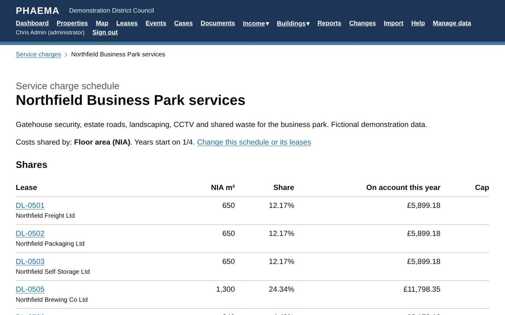
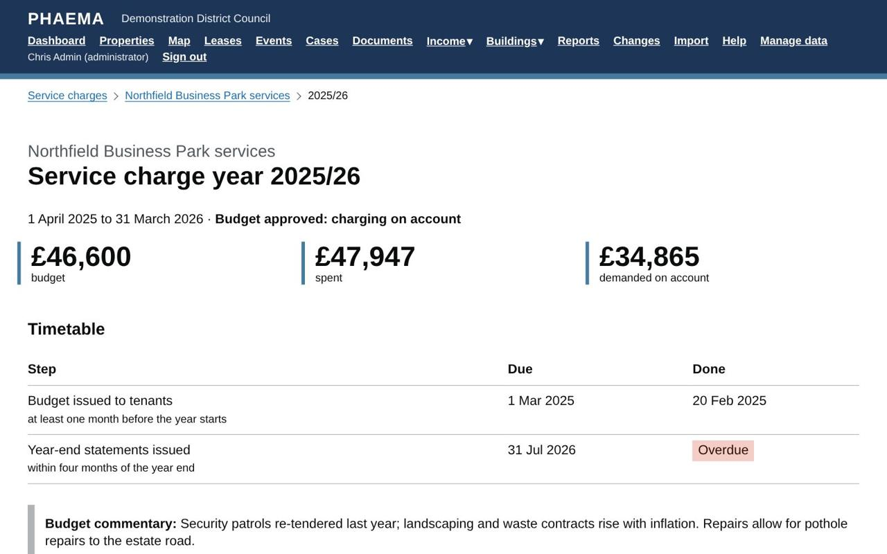
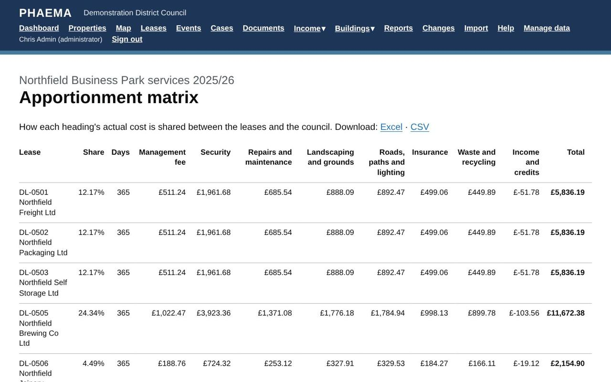

title: Service charges
section: Key dates
order: 5
summary: Schedules, shares, budgets, on-account demands, spending and the year-end reconciliation.
---
# Service charges

Service charges recover the cost of shared services, such as estate roads, landscaping, security and cleaning of
common parts, from the tenants who benefit. It is an optional module: an administrator switches it on in
[settings](settings.md#rent-ledger-settings), and it needs the [rent ledger](rent-ledger.md), because service
charges are demanded and collected through it. When it is on, **Service charges** appears in the menu.

The module follows the RICS professional standard *Service charges in commercial property* (2nd edition, in force
for service charge years starting on or after 31 December 2025): a budget issued to tenants before the year
starts, payments on account, and a year-end statement reconciling actual costs, with all income credited and
nothing recovered beyond actual cost.

## Schedules

A schedule is one pool of shared costs. Administrators set it up in **Manage data**, then **Service charge
schedules**:

- the **properties covered**, such as an estate or a building;
- **how costs are shared**: by floor area (NIA), by fixed percentages set for each lease, or equally per unit;
- when the **service charge year** starts, usually 1 April;
- the **contributing leases**, each with an optional **annual cap** if the lease limits the service charge.

Use separate schedules where different tenants pay for different things, for example one for the estate roads
and another for a building's lift.

## Shares

Shares are worked out over all the lettable units in the schedule, **including empty ones**. The council pays
the share of any unit that is not let (the void share), as a landlord normally must. The schedule page shows
each lease's floor area, share and on-account payment, and the council's share.

*Each lease's share, and the council's for empty units.*

## Budgets and payments on account

For each year, add the **budget** by cost heading (cleaning, security, repairs and so on) in **Manage data**,
then **Service charge years**. Add a **budget commentary** explaining the main changes and planned works; it appears on each tenant's budget
statement. When the budget is agreed, open the year and select **Approve the budget**.

Each lease has a printable **budget statement** (the **Budget** link on the year page) showing the schedule's
budget by heading, the commentary, the tenant's share and what they will pay on account each year and each
payment. When the statements have gone to tenants, record the date under **Timetable**.

From then on, every [demand run](rent-ledger.md#raising-rent) also charges each lease its share of the budget,
on its rent payment dates, as **service charge on account**. You can choose to charge rent only, service charges
only, or both. Where a payment period runs over the end of the service charge year, it is split, and each part is
charged at its own year's budget. VAT is added where the lease is VAT chargeable.

## Spending

Record what the council actually spends on each heading during the year:

- in **Manage data**, on the year, or
- by importing it from the finance system: **Import**, then **Service charge spending**. Each row gives the
  schedule, date, heading, supplier, description, invoice reference and amount. The date decides which year the
  cost falls in. A row with an invoice reference already recorded for that year is not added twice.

Two kinds of entry need care:

- **Income and credits**, such as interest on the service charge account, rebates and insurance commissions,
  must be credited to the service charge. Record them with the type **Income** (positive amounts); they reduce the
  total shared between tenants.
- **Costs not recoverable from tenants**, such as improvements or costs the leases do not allow, are recorded
  with **Recoverable** unticked. The council bears them, and they are shown separately on statements.

Each cost can also be given a **category**:

- **Improvement**: the RICS service charge standard treats improvements as not recoverable unless the lease
  allows them or tenants have agreed. PHAEMA will not save a recoverable improvement unless **Tenants agreed** is
  ticked.
- **Building Safety Act defect**: costs of remedying relevant defects that the Building Safety Act 2022 protects
  leaseholders from. These are always recorded as not recoverable.

The spending import has **Category** and **Tenants agreed improvement** columns for these.

The year page compares **budget and actual** by heading, and can be downloaded to Excel.

## Timetable

RICS expects the budget to reach tenants **at least one month before the year starts**, and the year-end
statements **within four months of the year end**. Each year's page shows both due dates and the dates you
record against them, marking anything late or overdue. Deadlines in the next 60 days, and any overdue, appear on
the dashboard and the Service charges page, and administrators get a list by email every Monday. PHAEMA also
reminds you to set up next year's budget as the current year draws to a close.

*The year page: budget, actual and the RICS timetable.*

When the year-end statements are issued, record the date, who certified them and any accountant's review.

If you record a budget or statements as issued **after the due date**, PHAEMA asks for the reason. The standard
expects tenants to be told why, so the reason is printed on the budget and statements, with an apology.

## Apportionment matrix

The **Apportionment matrix** link on each year shows how every heading's cost is split between the leases and the
council (empty units, part years and caps), using the budget until spending is recorded and actual costs after.
Download it to Excel to send with the budget or statements. At reconciliation the matrix is saved with the year, so
it always shows exactly what was charged.

*Every heading split across every lease.*

## Year-end reconciliation

After the year ends and all the spending is in, open the year and select **Reconcile the year**. For each lease,
PHAEMA works out:

1. its share of the **actual** spending;
2. scaled by the **days it was in force** in the year, for leases that started or ended during it;
3. limited by any **cap**;
4. less what it was **charged on account**.

The result is a **balancing charge** (the tenant owes more) or a **balancing credit** (the tenant paid too much).
The preview also shows how much the council bears for empty units, part years and caps. Confirm it and PHAEMA
raises the balancing charges and credits on the tenants' rent accounts, numbered and ready for the next
[finance export](rent-ledger.md#the-finance-export), and closes the year.

The RICS professional statement recommends that tenants receive their year-end statement within four months of
the year end.

## Tenant statements

Each lease has a printable **service charge statement** for the year, linked from the year page. It shows the
schedule's budget and actual costs by heading, the tenant's share, the days and any cap applied, what was paid on
account, and the balance. Before the year is reconciled it is marked as a draft.

## Worked example

**Northfield Business Park services** shares the cost of the gatehouse security, roads, landscaping, CCTV and waste
between the eight leases on the business park, by floor area. Units 4 and 10 are empty, so the council pays their
shares. DL-0509 Northfield Training Services' lease caps its service charge at £1,800 a year, so anything above that
falls on the council too. The year page shows the budget, the actual spending to date and the timetable, and the
**Apportionment matrix** shows every heading split across the leases.
