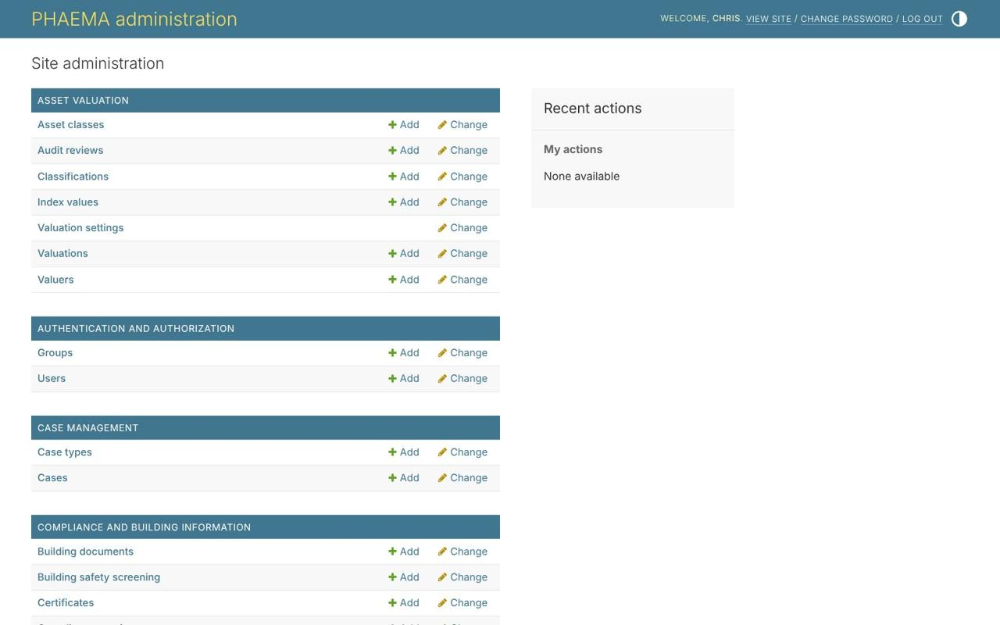
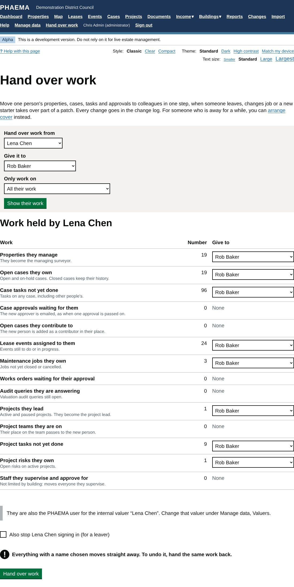

title: Users and roles
section: Running PHAEMA
order: 1
summary: What administrators, surveyors and viewers can do, and how to add users.
---
# Users and roles

Everyone who uses PHAEMA has a user account, one **role** and one or more **access areas**. The role decides what
they can change. The access areas decide which optional modules they can open (see [Access areas](#access-areas)).
Anyone with a role can see the core of PHAEMA: properties, leases, events, cases and documents.

| | Administrator | Surveyor | Contributor | Viewer |
|---|---|---|---|---|
| See the core of PHAEMA, run reports, download | Yes | Yes | Yes | Yes |
| Start cases and work on them | All | Their own, or on properties they manage | No | No |
| Add notes, documents and emails to cases | All | As above | Cases they are added to | No |
| See confidential case notes | Yes | Cases they own | No | No |
| Change properties | All | Those they manage | No | No |
| Change leases, breaks, rents, documents and events | All | On properties they manage | No | No |
| Change parties' details | Yes | Yes | No | No |
| Titles, INSPIRE boundaries, settings | Yes | No | No | No |
| Import from spreadsheets | Yes | Receipts and service charge spending, in the Finance area | No | No |
| Raise rent, credit notes and finance exports | Yes | In the Finance area | No | No |
| Add users and give roles | Yes | No | No | No |
| Change ready-made reports | Yes | No | No | No |

A surveyor **manages** a property when they are its managing surveyor. They can change the agreements that include
that property and the events on those agreements.

**Contributors** are colleagues outside the estates team, such as the legal officer, who work on particular
cases. Add them to a case in its **People** section.

Someone who can sign in but has no role sees a "no access" page until an administrator gives them one.

## Access areas

Not everyone needs every module. Access areas are named groups that open the optional modules. A person can be in
more than one, and administrators can always open everything the council has switched on.

| Area | Opens | Typical people |
|---|---|---|
| Estates | Rent, arrears and service charges for their own patch (below) | Surveyors, Head of Estates |
| Finance | Rent ledger, service charges, asset valuation, and maintenance to read. Surveyors in Finance can raise rent, credit notes and finance exports, approve service charge budgets and import receipts | Finance officers |
| Maintenance and compliance | Maintenance and compliance | Building and facilities staff |
| Valuation | Asset valuation | Internal valuers |
| Legal | Nothing beyond the core; contributors work on the cases they are added to | The legal team |

Tick a person's areas on their user record, under **Access areas**. Administrators can change what each area opens
under **Manage data**, **Access areas**. When access areas arrived, everyone was put in all of them, so nothing
disappeared; narrow each person's access from there.

If someone opens a module their areas do not include, even by typing its address, PHAEMA refuses and tells them to
ask an administrator. Menus, dashboards, reports and the change log only show what they can open.

**Their own patch.** People in the Estates area see rent, arrears and service charges for:

- the properties they manage, and every part of them;
- the properties managed by everyone below them in the supervision chain, so a Head of Estates sees their whole
  team's, and the director above them sees all of that too;
- the patch of anyone they are covering for (below).

A lease over several properties appears for every surveyor whose patch includes one of them. Properties with no
managing surveyor appear only for Finance and administrators. Demand runs and finance exports need the whole rent
ledger.

Changes to a person's areas are recorded in the [change log](change-log.md).

## Cover for absence

While someone is away, another person can cover their patch. Administrators can arrange cover for anyone;
supervisors for anyone in their supervision chain. Use **Arrange cover for absence** on My work, or the link on
Hand over work.

Choose who is away, who is covering, and the first and last days. The person covering sees the absent person's
patch as their own until the end of the last day, then it stops automatically. **End now** stops cover early,
and **Cancel** removes cover that has not started. Cover is recorded in the change log.

Cover adds what someone can see; it does not move work. To move properties, cases and tasks, use Hand over work.

## Adding a user

Administrators: select **Manage data**, then **Users**, then **Add user**. Set a username and a starting password,
then on the next page add their name and email address and choose one group: **Administrators**, **Surveyors**,
**Contributors** or **Viewers**. Their email address is used for [reminders](reminders.md).

*Manage data, where administrators add users and change settings.*

## Supervisors

Each surveyor needs a **supervisor and approver**, who approves their recommendations on [cases](cases.md#approvals).
On the user record, under **Staff details**, choose the supervisor and add a job title. The supervisor can be a
surveyor or an administrator, but nobody can approve their own work. The users
list shows each person's supervisor, and the dashboard tells administrators about any surveyor without one.

To stop someone using PHAEMA, untick **Active** on their user record rather than deleting it, so their name stays
on the records they changed. Hand their open work to colleagues first, as below.

## Handing over work

When someone leaves, changes job or a new starter takes over part of a patch, administrators can move their work
in one step with **Hand over work** in the menu (also linked from each user record).

*Handing over Lena Chen's work to Rob Baker in the demonstration data.*

1. Choose who the work comes **from**, who it goes **to**, and optionally **Only work on** one estate, site or
   building to hand over just that part of their patch.
2. Select **Show their work**. PHAEMA counts what they hold: properties they manage, open cases they own, case
   tasks not yet done, case approvals waiting for them, open cases they contribute to, lease events assigned to
   them, maintenance jobs they own, works orders waiting for their approval, valuation audit queries, projects they lead, their places on
   project teams, project tasks and risks they own, and the staff they supervise.
3. For each kind of work, keep the person you chose, pick someone else, or choose **Leave with** to keep it where
   it is. Properties, cases and approvals can only go to surveyors and administrators, and maintenance jobs and valuation
   queries only to people whose access areas open those modules; contributors can also take
   over case contributions and project team places, tasks and risks.
4. For a leaver, tick **Also stop them signing in**. Then select **Hand over work**.

Closed cases, stopped or closed projects, completed tasks and past approvals keep the original names, so the history stays true. Every record
moved is listed in the [change log](change-log.md) under your name. To undo a hand-over, hand the same work back.
If the person is also an internal valuer, change the valuer record under **Manage data**, **Valuers**.
