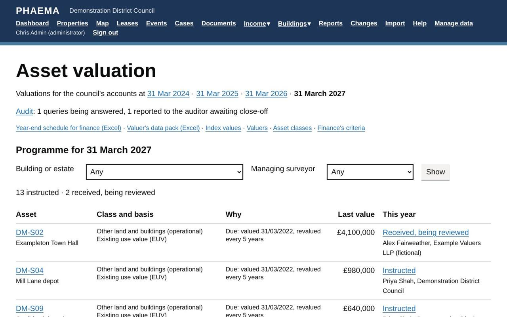
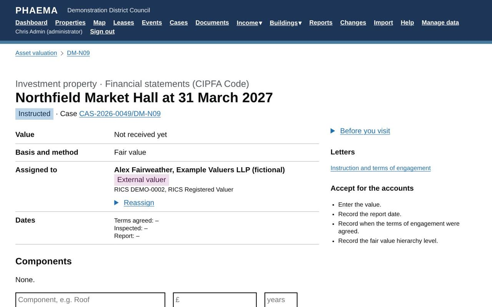

title: Asset valuation
section: Key dates
order: 8
summary: Asset classes set by finance, the yearly valuation programme run as cases, Red Book records, impairment reviews and the year-end schedule.
---
# Asset valuation

The asset valuation module manages the valuations the council needs for its accounts, following the CIPFA Code
of Practice on Local Authority Accounting and the RICS Valuation – Global Standards (the Red Book) with its UK
national supplement. It is an optional module: an administrator switches it on in **Module settings**. Find it
under **Buildings**, **Asset valuation**.

## Finance's criteria

Finance sets the rules, under **Manage data**:

| Setting | What it is |
|---|---|
| Asset classes | Each class's measurement basis, how often it is revalued, any index used in the years between, and whether buildings are depreciated |
| Year end | Normally 31 March |
| De minimis | Assets worth less than this are left out of the programme |
| Componentisation | Buildings worth more than the threshold are valued in significant components (by default, any worth 20% or more of the building value) |
| Valuer rotation | How long an external firm or lead valuer is used before rotating |

PHAEMA starts with the classes in the CIPFA Code, as defaults for finance to confirm:

| Class | Basis | Revalued |
|---|---|---|
| Other land and buildings (operational) | Existing use value; depreciated replacement cost for specialised buildings | Every 5 years |
| Investment property | Fair value | Every year |
| Surplus assets | Fair value | Every 5 years |
| Assets held for sale | Lower of carrying amount and fair value less costs to sell | Every year |
| Heritage assets | As finance decides | Not revalued by default |
| Community assets, assets under construction | Historic cost | Not revalued |

## Classifying assets

Each top-level property needs an asset class. The first time, **Classify them from their holding purpose**
classifies every property from its holding purpose in the register. Change a class on the property's valuation
page with **Reclassify**, giving the date and reason (for example a Cabinet decision to dispose). The history is
kept.

## The yearly programme

The asset valuation page lists the assets due at the year end, and why: not valued yet, due on the class's cycle,
or reclassified since the last valuation. Download the **valuer's data pack** (Excel), with each asset's address,
UPRN, class, basis, tenure, floor areas, leases and rents, and last value, to send with the instructions.

*This year's programme.*

**Start the programme** (administrators) opens a programme case, and an **asset valuation case** for each asset,
owned by its managing surveyor, with an instruction recorded against it. The cases carry the task lists and the
supervisor approval described in [cases](cases.md).

## Assigning valuations

Every valuation is assigned to either a **member of council staff** or an **external valuer**:

- When starting the programme, choose who to assign every valuation to, or assign each one later.
- On a valuation's page, **Assign** or **Reassign** it: the list shows council staff (administrators and
  surveyors) and the external valuers set up under **Valuers**.

A member of staff is emailed, sees the valuation under **Assigned to you** on the asset valuation page and their
dashboard, can record it, and takes over its case. For an external valuer, the case stays with the managing
surveyor, who manages the instruction. The valuer's status (internal or external) is recorded with the valuation
and shown in the year-end schedule, as the accounts must disclose it.

## Recording a valuation

Values come back on each valuation's page, or all at once with the **Valuer's returned figures** import (see
[importing](import-export.md)). PHAEMA records what the Red Book expects a valuation to document:

*A valuation assigned to an external valuer.*

- the basis, method and purpose;
- when the terms of engagement were agreed;
- the valuation date and the report date, separately;
- the inspection date and its extent: full, external only or desktop;
- special assumptions and key assumptions;
- any material valuation uncertainty, with the valuer's statement;
- the valuer, whether internal or external, their RICS number, and any conflicts of interest declared;
- for fair value, the **fair value hierarchy level** (1, 2 or 3) the accounts must disclose;
- the value, split between land and buildings, the remaining life of the buildings, and significant components;
- the report itself.

PHAEMA checks that land and buildings add up to the value, and shows the change since the last valuation.

## Accepting for the accounts

An administrator (normally finance) selects **Accept** once the valuation is complete. PHAEMA will not accept a
valuation without a value, valuer, report date and terms of engagement, or a building over the componentisation
threshold without its components. Accepted valuations are locked; an administrator can reopen one.

## Audit

Valuations can be flagged for the external auditor, answered and closed off:

1. **Flag for audit** (administrators), on the valuation's page: why (selected in the auditor's sample, an
   auditor's query, flagged by finance, or an internal review), the auditor, their query, and when the response is
   due. By default the response is prepared by the valuer (if council staff) or the managing surveyor, who is
   emailed and sees it on their dashboard.
2. **Record the response sent to the auditor**, with any evidence, and the date it was reported. The status
   becomes *Reported to the auditor*.
3. **Close** (administrators) when the auditor is satisfied, with the outcome: no change, valuation amended,
   accounts adjusted, or other. If the valuation is to be amended, closing reopens it so it can be changed and
   accepted again.

Each step is also noted on the valuation's case. The **Audit** page lists every flagged valuation for each year's
accounts by status, and downloads the audit log for the auditor as Excel.

## Impairment and material change

PHAEMA prompts a review when something happens after a valuation that may affect value: a change of occupation or
holding purpose, a lease ending, an emergency repair, or a component graded D. **Open a review** starts an
impairment review case with the reasons in its notes.

## The year-end schedule

**Year-end schedule for finance** downloads every classified asset with its class, basis, valuer, valuation date,
value, land and buildings split, remaining life, material uncertainty and components, for the fixed asset
register and the working papers. It also gives the fair value level and the **indexed value**.

### Indexation between valuations

Between full valuations, the CIPFA Code expects the council to check that carrying amounts are not materially
different from current value. Each asset class can name an index, for example the BCIS All-in Tender Price Index
for operational buildings. Administrators record index values under **Index values** on the Asset valuation
page. PHAEMA then brings the last accepted value forward to the year end: the index is applied to the buildings
only when land and buildings are split, and to the whole value otherwise. The indexed value and the factor appear
on the property's valuation page and in the schedule. It is a guide for deciding whether a revaluation is needed,
not a valuation.

## Worked example

In this year's programme, the water tower telecoms site (DM-N07) and Hilltop Farm (DM-N10) are assigned to Lena
Chen as a council staff valuer, so they appear under **Assigned to you** for her; the rest go to the external
valuer. Last year's valuation of
**Northfield Market Hall** was flagged for audit: the auditor asked about the turnover rent assumption and the
yield. Rob Baker, the managing surveyor, prepares the response; when it has been sent he records it as reported,
and finance closes it off once the auditor is satisfied.
